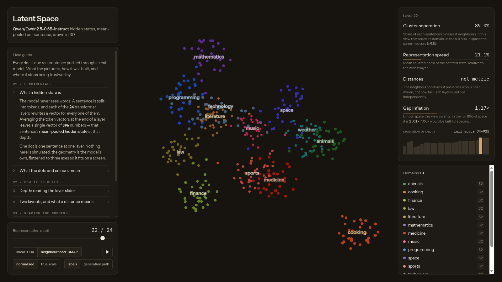

# Latent Space — a 3D view of a real LLM's hidden states

A single-page WebGL explorer of the internal representation space of
`Qwen/Qwen2.5-0.5B-Instruct`. Every point is a real sentence run through the real
model; nothing is simulated, and every number in the UI is measured.

Live: https://jacoblbagent.github.io/latent-space-viz/ — local: :5205, in the
Visualizations hub at https://jacoblbagent.github.io/visualizations/.



## What is actually plotted

416 hand-written sentences across 13 domains (animals, cooking, programming,
mathematics, weather, music, medicine, law, space, sports, finance, literature,
technology) — 32 per domain, so every cluster is a real sample rather than a
handful of points. Each sentence is pushed through the 0.5B-parameter model and the
**mean-pooled hidden state of every layer** is captured: 25 tensors of 896
dimensions each (embedding layer + 24 transformer layers).

Two layouts of the same activations are offered:

| Layout | What it is | Distances mean something? |
|---|---|---|
| `linear · PCA` | One common linear basis for all layers: PCA over the union of every layer's per-layer-centred, unit-RMS states. A single shared frame, so the layer slider animates the representation in a fixed coordinate system rather than a per-layer rotation. Axis labels show each principal axis's real share of total variance. | Yes |
| `neighbourhood · UMAP` | UMAP (cosine, `n_neighbors=100`, `min_dist=0.6`) per layer, so semantic neighbours land near each other. Both numbers are chosen by measurement, see below. | No — neighbour structure only |

## Why two layouts

Two different things are measured, because a 3D picture can fail in two ways: it
can lose the structure, or it can invent structure that is not there.

**Losing it.** Cluster separation (the share of each sentence's 5 nearest
neighbours that share its domain) is measured in the full 896-d space and again
inside each 3D layout. At layer 23 the full space separates 92% and the UMAP
layout 90%, while the linear projection shows 40%. The semantic structure of
these activations is not three-dimensional, and a linear projection of it is a
cigar, not a cluster map.

**Inventing it.** The gaps between clusters are also measured: the distance to the
nearest other-domain point, divided by how spread out a domain is itself. In the
full 896-d space, at layer 22, that gap ratio is 1.01× — the domains are
**separable, not moated**. The first UMAP settings used here (15 neighbours,
`min_dist=0.12`) inflated it to 3.47×, i.e. they drew a moat three times wider
than the data has. `n_neighbors=100, min_dist=0.6` — the pair that wins
`scripts/layout_tune.py` — holds the inflation at 1.17× while keeping separation
at 92%. With very few points per domain the same settings inflated it further,
which is one reason the corpus was doubled to 32 sentences per domain.

The metrics panel reports, per layer:

- **Cluster separation** — 5-NN topic purity inside the view you are looking at, and in the full space for comparison.
- **Representation spread** — mean squared norm of the centred state; it grows about 1000x from layer 0 to layer 24.
- **Variance on the three axes** (PCA view) — how much of that layer's variance the plotted axes capture.
- **Gap inflation** — how much wider the gaps read in this view than in the full space. Below 1.00× means the view is collapsing domains onto each other, which is exactly what the linear projection does (0.40× at layer 22).

The bar strip under those numbers is the full-space separation for all 25 layers;
click any bar to jump to that depth.

## The field guide

The left column carries a tiered guide, not just a title: four tiers (fundamentals,
how it is built, reading the numbers, limits) holding seven collapsible sections.
Each section states what the thing is and what it costs — a hidden state, the point
colour, the layer slider's four regimes, PCA versus UMAP, the four readouts, the
scale toggles and the generation path, and the four things the picture cannot tell
you. It quotes the real counts, read from `data/latent.json`, and
scrolls independently between the header and the controls. It hides below 620px of
viewport height and under 1000px of width, where the canvas needs the room.

## Things worth looking at

- Layer 0-2: near-isotropic and tiny — the embedding table's directions are not yet organised by meaning.
- Layers 3-21: variance collapses into a few "rogue" directions (the three PCA axes hold ~94% of it), and topical purity plateaus around 45-60%.
- Layers 22-23: purity jumps to ~92% and, in the neighbourhood layout, 13 tight domain islands appear.
- Layer 24: the norm explodes to ~1000x every other layer, the signature of the huge activations feeding the output head.
- **Generation path** (toggle): the model is asked to write a sentence about the ocean; its greedy 40-token output is embedded step by step and drawn as a path through the final layer's PCA frame. The trajectory stays in one neighbourhood instead of wandering.

## Running it

```bash
./start-latent-space-viz.sh      # prints the URL, serves the repo root
```

Static files only — `index.html`, `three.min.js`, `fonts.css`, `fonts/`, `data/latent.json` —
so any static server works and GitHub Pages serves it with no build step. It must
be served over HTTP (the page fetches `data/latent.json`), not opened as `file://`.

## Rebuilding the data

```bash
python3 -m venv .venv
.venv/bin/pip install torch --index-url https://download.pytorch.org/whl/cpu
.venv/bin/pip install transformers safetensors umap-learn
.venv/bin/python scripts/extract.py    # model forward passes -> data/hidden.npz, data/traj.npz
.venv/bin/python scripts/project.py    # PCA + UMAP + metrics  -> data/latent.json
```

`scripts/basis_experiment.py` and `scripts/layout_compare.py` are the evidence
runs behind the layout choices: they compare candidate bases and layout methods
using the measured 3D separation rather than eyeballing a render.

## Files

```
data/corpus.json          the 416 sentences, grouped by domain (32 each)
data/hidden.npz           [25 layers, 416 sentences, 896 dims] real hidden states
data/traj.npz             per-token final-layer states for the generation path
scripts/extract.py        model -> hidden states
scripts/project.py        hidden states -> 3D + metrics -> data/latent.json
scripts/fetch_fonts.py    self-hosts the two typefaces
scripts/layout_tune.py    picks the UMAP spacing by measuring gap inflation vs separation
scripts/layout_spacing.py how wide the gaps are, in the full space and in 3D
index.html                the viewer (three.js r160, no build step), field guide included
three.min.js              local three.js
fonts.css, fonts/         Instrument Sans + IBM Plex Mono, latin subset
assets/favicon.svg        the hub's favicon
```

## Caveats

- 416 sentences is still a small sample; the layer profiles are indicative, not a benchmark.
- UMAP started from 15 neighbours and `min_dist=0.12`, which drew a moat 3× wider
  than the data supports. The current pair is tuned on this corpus; re-run
  `scripts/layout_tune.py` after any change to the corpus or the model, because
  fewer points per domain inflates the gaps further.
- UMAP layouts are stochastic per layer and computed independently, so positions
  are not comparable between layers — only within one layer.
- The `true scale` toggle uses real per-layer norms; the `normalised` toggle fits
  each layout into a fixed cube so every depth is readable. Shapes differ between
  the two modes because the former is dominated by norm growth.
- Sentence-level mean pooling is one summary of a layer; token-level geometry is not shown.
